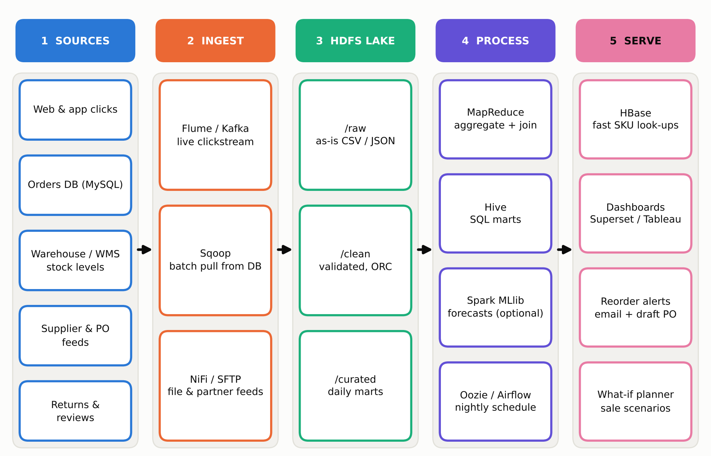
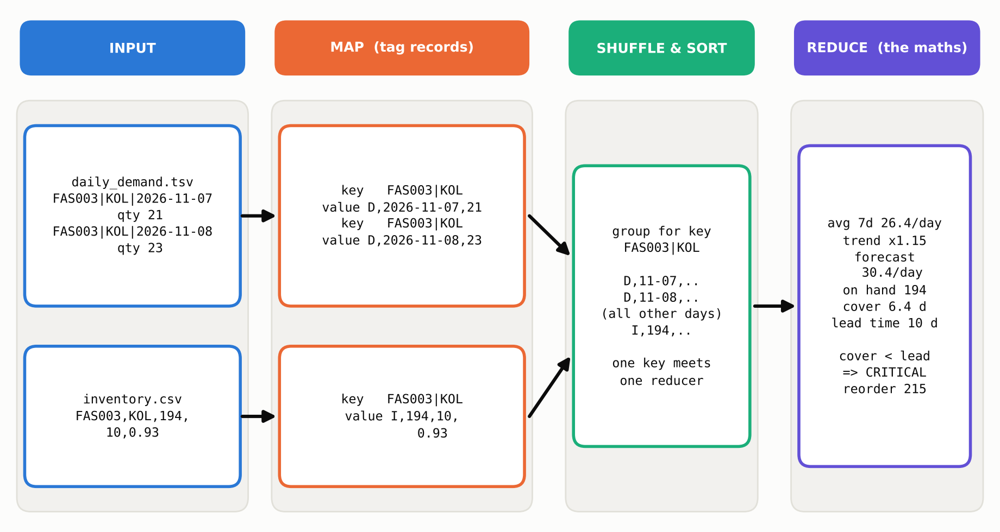

# Architecture and design notes

Raw files (orders, returns, inventory, supplier deliveries) land in HDFS. MapReduce jobs turn them into curated tables;
a small analysis layer (backtest, rebalancing LP, alerts, report) runs on the compact results.

## Job graph

| Step | Input | Mapper -> Reducer | Key | Note |
|------|-------|-------------------|-----|------|
| Net daily demand | orders + returns | `daily_demand_map` -> `sum_reduce` | `sku\|warehouse\|date` | two inputs, told apart by `mapreduce_map_input_file`; `sum_reduce` is also the combiner |
| Supplier scorecard | deliveries | `supplier_map` -> `supplier_reduce` | `supplier_id` | on-time, fill rate, observed lead mean/std, score, tier |
| Backtest (local, small) | daily demand | `analysis/backtest.py` | series x origin | picks the forecast method before the gap job |
| Gap engine | daily demand + inventory | `gap_map` -> `gap_reduce` | `sku\|warehouse` | reduce-side join (D/I tags); supplier stats via distributed cache (map-side join) |
| Festive uplift | orders | `uplift_map` -> `uplift_reduce` | `CAT\|..`, `SKU\|..` | weekday-adjusted vs the 28 days before the sale |
| Bundles | orders | 3 chained jobs | basket -> pair -> pair | counts, then support / confidence / lift in a single-reducer stage |
| Return rates | orders + returns | `return_rate_map` -> `return_rate_reduce` | `CAT\|..`, `SKU\|..` | combiner = `sum_reduce` |

## Decisions

- **The forecast method is chosen by the data.** Six methods are backtested (rolling origin, 7-day horizon) and the winner
  drives the gap engine: `naive7` on the synthetic data, `ma28` on the real Olist data. `FORECAST_METHOD` overrides it.
- **Safety stock uses observed lead time**, `SS = z * sqrt(L*sd_d^2 + d^2*sd_L^2)`, not the supplier's quote.
- **Risk labels**: CRITICAL if on-hand < lead-time demand and inventory position < reorder point; WATCH if position < ROP;
  OVERSTOCK if cover > 45 days; otherwise OK.
- **Rebalancing** only uses a lane when the transfer is faster than the recipient's supplier lead time; unmet need carries a large penalty.
- **Returns** are subtracted on the day they arrive back, so the most recent days look slightly better than they will.

## Running on a cluster

`scripts/run_hadoop.sh` uploads the data to HDFS, runs each job with `hadoop jar hadoop-streaming-*.jar`, ships the shared
modules and `supplier_stats.tsv` with `-files`, passes configuration with `-cmdenv`, and finally pulls the small results back
for the analysis layer. It is untested; `hive/` holds reference HiveQL for the SQL-friendly steps.
