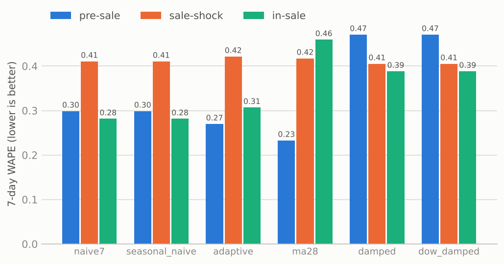
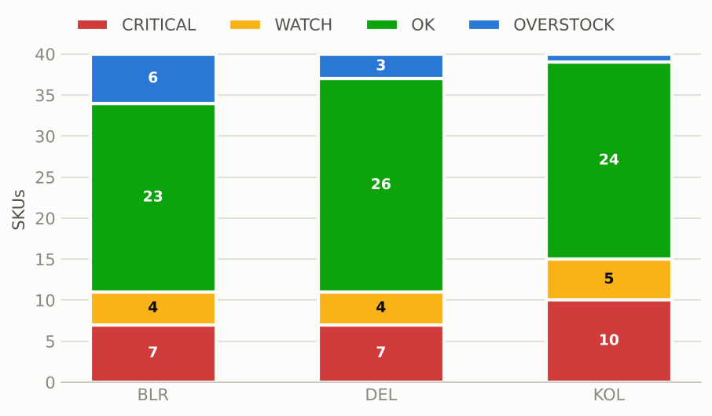
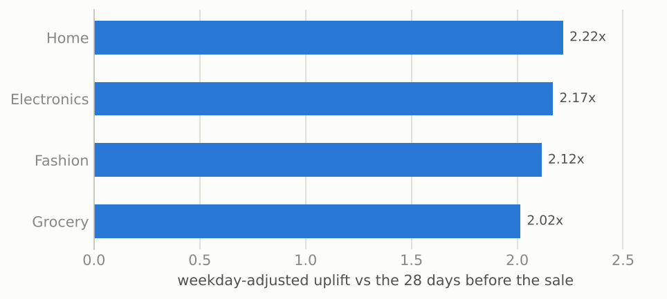
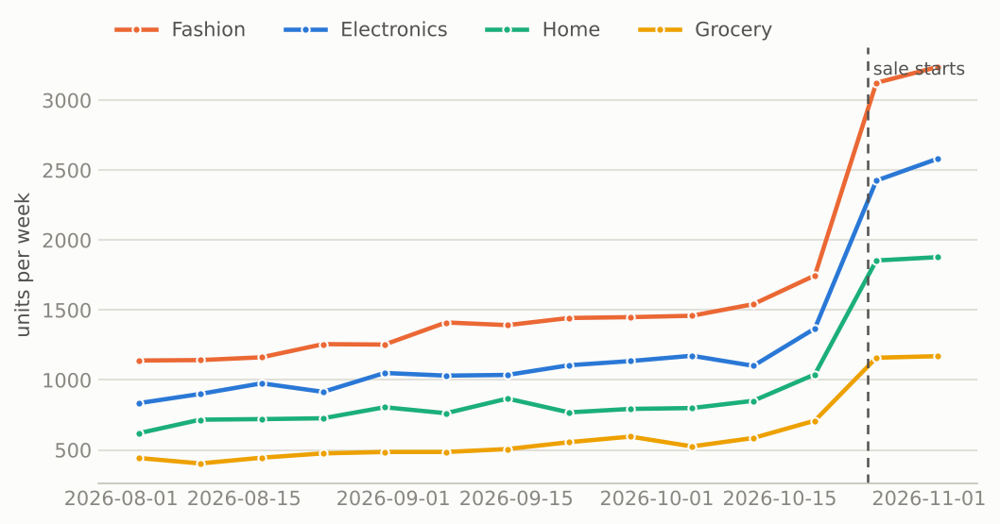
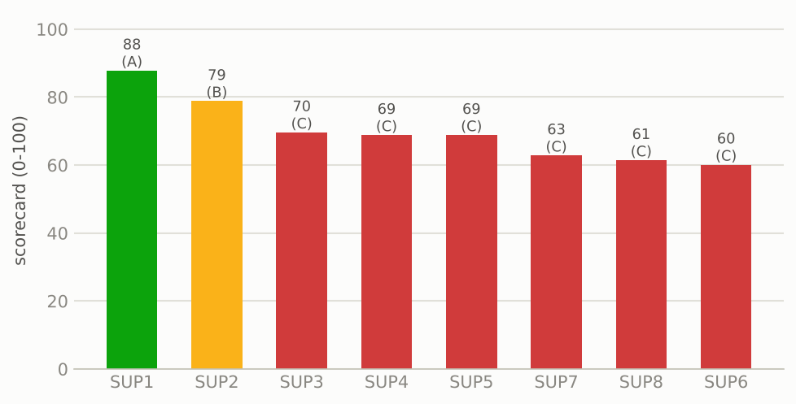
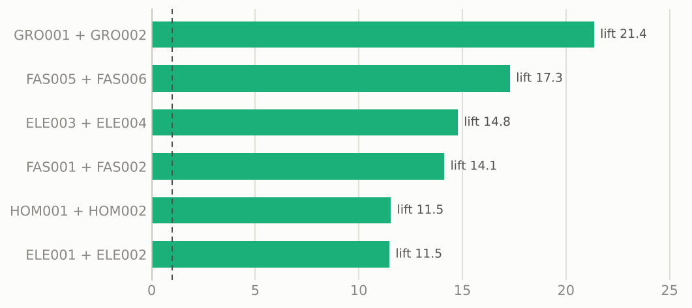
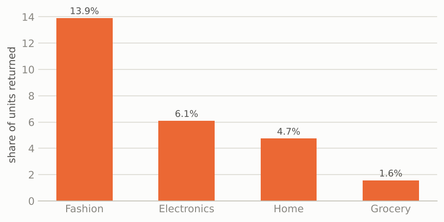

# Results report (synthetic data, as of 2026-11-08)

Generated by `scripts/run_local.sh`. All data is synthetic, so these numbers show that the pipeline works, not how any real store behaves.

| | |
|---|---|
| Order lines / baskets | 39,711 / 35,286 |
| SKU-warehouse pairs | 120 |
| Risk | 24 CRITICAL, 13 WATCH, 73 OK, 10 OVERSTOCK |
| Forecast method in use | `naive7` |
| Transfers proposed | 19 (508 units, Rs 10,072 freight) |
| Festive-sale uplift | 2.13x average across categories |

## Idea 1. Demand forecasting

Six methods are scored with a rolling-origin backtest (28 origins x 120 series, 7-day horizon). Lower WAPE is better.

| method | wape_week | wape_daily | bias |
|---|---|---|---|
| naive7 | 0.323 | 0.535 | -0.199 |
| seasonal_naive | 0.323 | 0.653 | -0.199 |
| adaptive | 0.327 | 0.539 | -0.220 |
| ma28 | 0.378 | 0.565 | -0.316 |
| damped | 0.418 | 0.604 | 0.022 |
| dow_damped | 0.418 | 0.673 | 0.022 |

`naive7` has the lowest 7-day WAPE overall, so it is the default. Every method under-forecasts around the sale start because no history-based method can see a promotion coming; feed the planned promotion calendar in as a feature to fix that.

## Idea 2. Stock-out early warning

Most urgent pairs (stock-out expected before a new order could arrive):

| sku | warehouse | supplier_id | tier | on_hand | cover_days | lead_mean | days_late | order_qty |
|---|---|---|---|---|---|---|---|---|
| ELE005 | KOL | SUP5 | C | 8 | 1.8 | 7.8 | 7 | 49 |
| FAS004 | DEL | SUP8 | C | 16 | 3.4 | 9.9 | 7 | 113 |
| ELE004 | BLR | SUP4 | C | 18 | 1.7 | 6.9 | 6 | 180 |
| ELE012 | KOL | SUP4 | C | 31 | 1.8 | 6.9 | 6 | 143 |
| HOM003 | BLR | SUP5 | C | 17 | 2.1 | 7.8 | 6 | 158 |
| FAS009 | KOL | SUP5 | C | 8 | 2.2 | 7.8 | 6 | 59 |
| GRO001 | BLR | SUP3 | C | 7 | 1.2 | 5.8 | 5 | 94 |
| FAS002 | KOL | SUP6 | C | 30 | 4.4 | 9.1 | 5 | 88 |

Full list with actions: `alerts.csv` (37 rows).

## Idea 3. Smart reorder points

An (s, S) policy: safety stock `z * sqrt(L*sd_d^2 + d^2*sd_L^2)` at a 95% service level, using the supplier's OBSERVED lead-time mean and spread, not the quoted lead time. `gap_report.csv` holds `safety_stock`, `reorder_point`, `order_up_to`, `order_qty` and the latest safe `order_by` date; `purchase_orders.csv` is the resulting order list after transfers.

## Idea 4. Warehouse rebalancing

An integer linear program per SKU moves surplus stock to short warehouses when that beats the supplier lead time: **19 transfers, 508 units, Rs 10,072 freight** across 17 SKUs. Lane costs are assumptions.

| sku | from | to | units | freight_cost | transfer_days | need_at_destination |
|---|---|---|---|---|---|---|
| ELE001 | KOL | DEL | 38 | 684 | 3 | 38 |
| ELE004 | DEL | BLR | 91 | 1820 | 2 | 91 |
| ELE005 | BLR | KOL | 12 | 264 | 3 | 12 |
| ELE006 | KOL | DEL | 4 | 72 | 3 | 4 |
| ELE010 | KOL | DEL | 57 | 1026 | 3 | 57 |
| FAS002 | DEL | KOL | 29 | 522 | 3 | 29 |
| FAS004 | BLR | DEL | 8 | 160 | 2 | 59 |
| FAS005 | BLR | KOL | 2 | 44 | 3 | 2 |

## Idea 5. Festive-sale uplift

Uplift is weekday-adjusted against the 28 days before the sale. It includes the organic upward trend (0.4% per day in the generator), so it reads slightly above the planted 1.9x.

| category | base_avg_day | sale_avg_day | plain_ratio | uplift |
|---|---|---|---|---|
| Electronics | 164.07 | 360.07 | 2.19 | 2.17 |
| Fashion | 212.68 | 455.47 | 2.14 | 2.12 |
| Grocery | 82.86 | 168.40 | 2.03 | 2.02 |
| Home | 119.50 | 268.67 | 2.25 | 2.22 |

Highest-uplift SKUs: ELE007 (4.41x), FAS013 (3.57x), FAS005 (3.33x), FAS004 (2.90x), ELE003 (2.53x). Low-volume SKUs are noisy, so read SKU-level uplift together with its sale-day count.

## Idea 6. Supplier scorecard

| supplier_id | n_pos | on_time_rate | quoted_lead | lead_mean | lead_gap | lead_std | fill_rate | score | tier |
|---|---|---|---|---|---|---|---|---|---|
| SUP1 | 80 | 0.81 | 4.00 | 3.88 | -0.12 | 0.70 | 0.97 | 87.80 | A |
| SUP2 | 80 | 0.62 | 5.00 | 5.00 | 0.00 | 1.07 | 0.95 | 78.80 | B |
| SUP3 | 76 | 0.40 | 5.00 | 5.79 | 0.79 | 1.17 | 0.95 | 69.60 | C |
| SUP4 | 83 | 0.40 | 6.00 | 6.88 | 0.88 | 1.43 | 0.93 | 68.80 | C |
| SUP5 | 77 | 0.46 | 7.00 | 7.81 | 0.81 | 2.10 | 0.90 | 68.80 | C |
| SUP6 | 83 | 0.27 | 7.00 | 9.06 | 2.06 | 2.37 | 0.87 | 60.10 | C |
| SUP7 | 86 | 0.33 | 4.00 | 5.52 | 1.52 | 1.99 | 0.93 | 62.80 | C |
| SUP8 | 80 | 0.38 | 8.00 | 9.95 | 1.95 | 3.07 | 0.81 | 61.40 | C |

`lead_gap` is observed minus quoted lead time. Planning with the quote would understate the risk for every supplier with a positive gap.

## Idea 7. Bundle pre-positioning

| sku_a | sku_b | pair_orders | support | conf_a_to_b | conf_b_to_a | lift |
|---|---|---|---|---|---|---|
| GRO001 | GRO002 | 200 | 0.006 | 0.400 | 0.303 | 21.350 |
| FAS005 | FAS006 | 203 | 0.006 | 0.590 | 0.169 | 17.290 |
| ELE003 | ELE004 | 348 | 0.010 | 0.571 | 0.255 | 14.770 |
| FAS001 | FAS002 | 338 | 0.010 | 0.243 | 0.556 | 14.120 |
| HOM001 | HOM002 | 453 | 0.013 | 0.279 | 0.531 | 11.540 |
| ELE001 | ELE002 | 647 | 0.018 | 0.484 | 0.434 | 11.470 |

9 bundle alerts in `bundle_alerts.csv` (one item of a strong bundle is short). Bundles with lift >= 3 should be stocked in the same warehouses.

## Idea 8. Returns-adjusted demand

| category | ordered | returned | return_rate |
|---|---|---|---|
| Electronics | 17901 | 1090 | 0.061 |
| Fashion | 23146 | 3219 | 0.139 |
| Grocery | 8667 | 135 | 0.016 |
| Home | 13387 | 634 | 0.047 |

Over the last 28 days gross demand was 26,373 units and net demand 24,398 (7.5% lower). The forecast uses NET demand, with returns counted on the day the goods come back.

## Caveats

- Synthetic data: results validate the pipeline, not a business.
- The rolling backtest runs on the generator's own patterns; re-run it on real data before trusting a method.
- Returns are counted on the return date, so recent order days look better than they will once their returns arrive.
- Freight cost and transfer time per lane are assumptions (`rebalance.DEFAULT_LANES`).
- Bundle lift for rare pairs is noisy; `MIN_PAIR_COUNT` drops pairs seen in fewer than 15 baskets.
